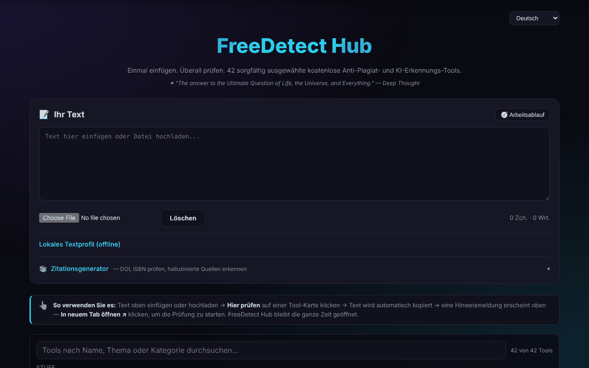

# FreeDetect Hub

[English](README.md) · [Română](README.ro.md) · [Français](README.fr.md) · [Italiano](README.it.md) · [Español](README.es.md) · [Português](README.pt.md) · **Deutsch** · [Magyar](README.hu.md)

**Version:** 1.3.4 · **Zuletzt aktualisiert:** 2026-10-22

Ein einziges Panel für 42 kostenlose Werkzeuge zur Erkennung von Plagiaten und KI-generierten Texten, plus ein Zitationsgenerator.

**Online-App:** https://chiuta.github.io/FreeDetect/

## Was es ist

FreeDetect Hub („Paste once. Check everywhere.“) ist eine HTML-Anwendung in einer einzigen Datei (mit den PDF- und DOCX-Bibliotheken im Verzeichnis `vendor/`). Du fügst einen Text einmal ein oder lädst ihn hoch und wählst dann aus einem Raster von 42 von Hand ausgewählten externen Werkzeugen; der Text wird in die Zwischenablage kopiert und das gewählte Werkzeug öffnet sich in einem neuen Tab, wo du ihn einfügst.

Die App führt die Prüfung nicht selbst durch: Sie ist ein Katalog und eine Hilfe für den Arbeitsablauf. Die Ergebnisse der Detektoren können fehlerhaft sein (falsch positiv), besonders bei nicht-englischen Texten, auch bei rumänischen; die App weist ausdrücklich darauf hin.

## Funktionen

- Textfeld „Your Text“ zum direkten Einfügen oder zum Hochladen von Dateien `.txt`, `.md`, `.docx`, `.pdf`.
- Werkzeugraster mit Filtern nach Stufe (Tier: Einsteiger / Profis) und nach Kategorie (KI, Plagiat, Bibliografie, Bild usw.).
- Schaltfläche „Check here“ bei jedem Werkzeug: Sie kopiert den Text in die Zwischenablage und zeigt ein Banner mit „Open in new tab“.
- Suche im Katalog (Name, Thema, Kategorie; diakritische Zeichen werden ignoriert), mit einem Zähler „n von 42“ und einer klaren Meldung, wenn es keine Ergebnisse gibt; Escape leert die Suche.
- „Lokales Textprofil (offline)“: Wörter, Sätze, durchschnittliche Länge und deren Schwankung, Wortschatzvielfalt, Lesezeit, gefundene DOIs und wiederholte Dreiwortfolgen. Das sind beschreibende Statistiken, kein Test auf Plagiat oder KI-generierten Text (der Hinweis wird im Panel angezeigt). Die neuen Texte der Suche und des Profils sind ins Rumänische und Englische übersetzt; in den anderen Sprachen erscheinen sie auf Englisch.
- Panel „Workflow“ (empfohlener Ablauf in 7 Schritten) und Schaltfläche „Clear“.
- Zitationsgenerator: Du gibst eine DOI, ISBN oder URL ein, „Fetch“ prüft lokal die Prüfziffer der ISBN, ruft die Metadaten von Crossref / OpenLibrary ab und erzeugt APA, MLA, Chicago oder BibTeX, mit „Copy“.
- „Scan input text“: findet die DOIs im Text und prüft sie bei Crossref, um möglicherweise erfundene Quellenangaben zu kennzeichnen.
- Oberfläche in 15 Sprachen (Auswahl 🌐): Englisch, Rumänisch, Französisch, Deutsch, Spanisch, Portugiesisch, Italienisch, Niederländisch, Polnisch, Russisch, Arabisch, Chinesisch, Japanisch, Koreanisch, Türkisch.
- Seiten zu Datenschutz/DSGVO, Cookies und Impressum, Buy-Me-a-Coffee-Links.

## Neue Funktionen (1.1.0)

- **Prüfung auf personenbezogene Daten vor „Check here“**: Der Text wird lokal gescannt; wenn E-Mail-Adressen, Telefonnummern, IBANs, CNP (rumänische Personenkennzahlen) usw. auftauchen, kannst du maskieren, fortfahren oder abbrechen. Maskiert wird nur der in die Zwischenablage kopierte Text; das Textfeld bleibt unverändert.
- **Katalogsuche nach Relevanz**, mit Synonymen (plagiat/plagiarism, AI/GPT, citare usw.) und Fehlertoleranz; neben dem Zähler erscheint „· după relevanță“ (nach Relevanz). Der alte wörtliche Abgleich bleibt erhalten.
- **„Export profile (.md)“**: speichert das lokale Textprofil als Markdown-Datei (Statistiken, nicht den Text).
- Die gemeinsamen „fff-kit“-Module sind enthalten; die `.fff.json`-Kopie aus dem Versionsdialog enthält nur die Oberflächensprache.
- Die neuen Texte liegen in allen 15 Oberflächensprachen vor; **die Übersetzungen wurden nicht von Muttersprachlern geprüft.**

## Anleitung

1. Öffne die Seite und ändere bei Bedarf die Sprache über die Auswahl 🌐 (die Wahl wird gespeichert).
2. Füge den Text in „Your Text“ ein oder lade eine Datei `.txt`, `.md`, `.docx` oder `.pdf` hoch.
3. Verwende die Filter Tier und Category, um das Werkzeugraster einzugrenzen.
4. Drücke „Check here“ bei 2–3 Detektoren; der Text wird automatisch in die Zwischenablage kopiert.
5. Drücke im erscheinenden Banner „Open in new tab“ und füge den Text dann (Strg+V / Cmd+V) in das geöffnete Werkzeug ein.
6. Vergleiche die Ergebnisse: Ein einzelnes Signal ist kein Beweis.
7. Für Quellenangaben: Öffne „Citation Generator“, gib eine DOI/ISBN ein und drücke „Fetch“, oder drücke „Scan input text“, um die DOIs im Text zu prüfen.
8. „Clear“ leert das Textfeld.

Tastatur: Die Eingabetaste im Feld des Zitationsgenerators führt ihn aus; Escape im Suchfeld leert es; weitere Kürzel gibt es nicht.

## Datenschutz und Netzwerk

- Lokal: Im `localStorage` wird nur die Oberflächensprache (`fdh_lang`) gespeichert. Dein Text wird nicht gespeichert.
- Der eingefügte Text wird von der App nirgendwohin gesendet. Die einzigen Netzwerkanfragen der Seite sind die des Zitationsgenerators, wenn er betätigt wird: `api.crossref.org` (DOI und Scan) und `openlibrary.org` (ISBN).
- Die Anfragen an Crossref enthalten die abgefragte DOI, deine IP-Adresse und den Parameter `mailto=alexio@trom.tf` (die Kontaktadresse des Autors, verwendet für den „polite pool“); die an OpenLibrary enthalten die ISBN und die IP. „Scan input text“ sendet an Crossref nur die im Text gefundenen DOIs, nicht den ganzen Text.
- Wenn du „Check here“ verwendest, gelangt der Text durch dein Einfügen zum gewählten Drittanbieter-Dienst und unterliegt dessen Richtlinien.
- Die Seite enthält Links (keine automatischen Anfragen) zu Dutzenden Drittanbieter-Diensten, zu Buy Me a Coffee und zu den Websites des Autors.

## Haftungsausschluss

Die aufgeführten Werkzeuge sind Dienste Dritter; die Ergebnisse von Plagiats- und KI-Text-Detektoren können fehlerhaft sein (falsch positiv), besonders bei Rumänisch, und stellen keinen Beweis dar. Der Katalog enthält auch Werkzeuge vom Typ „Humanizer“/Paraphrasierung, als solche aufgeführt, ohne zu empfehlen, die Regeln der akademischen Integrität zu umgehen. Marken gehören ihren Eigentümern (Handelsnamen ihrer Inhaber, beschreibend verwendet). Die „Humanizer“-Werkzeuge werden im Katalog nur als Information darüber geführt, was auf dem Markt existiert; der Autor empfiehlt sie nicht, um die Regeln der akademischen Integrität zu umgehen, und ihre Verwendung in Arbeiten, die diesen Regeln unterliegen, liegt in der Verantwortung der Nutzerin bzw. des Nutzers.

## Lokal / offline ausführen

Lade das Repository herunter (die Datei `index.html` und das Verzeichnis `vendor/`) und öffne `index.html` in einem Browser. Die Oberfläche, das Filtern und das Lesen lokaler Dateien funktionieren ohne Internet. Internet benötigen: der Zitationsgenerator (Crossref, OpenLibrary) und natürlich die externen Werkzeuge, die du öffnest.

## Lizenz

MIT, gemäß dem Header der App — siehe die Datei LICENSE. Achtung: Das Verzeichnis `vendor/` enthält Drittanbieter-Bibliotheken mit eigenen Lizenzen, die nicht von der MIT-Lizenz abgedeckt sind — `pdfjs/` (Mozilla pdf.js 3.x, Apache-2.0, gemäß dem Dateiheader) und `mammoth.browser.min.js` (mammoth.js, BSD-2-Clause gemäß dem Quellprojekt; der Lizenztext ist nicht in der Datei enthalten). Einzelheiten in [NOTICE.md](NOTICE.md).

## Autor

Alexio — Alexandru-Ionuț Chiuță, Kontakt: alexio@trom.tf

## Zusammenfassung

FreeDetect Hub ist ein HTML-Dashboard in einer einzigen Datei mit Links zu 42 handverlesenen kostenlosen Plagiats- und KI-Erkennungswerkzeugen. Füge Text ein oder lade ihn hoch (.txt, .md, .docx, .pdf), klicke auf „Hier prüfen“, um ihn in die Zwischenablage zu kopieren und das gewählte Werkzeug zu öffnen. Enthalten sind ein DOI-/ISBN-Zitiergenerator (Crossref, OpenLibrary) und ein Scanner für halluzinierte Literaturangaben. Oberfläche in 15 Sprachen. Nur die Zitierfunktionen greifen auf das Netzwerk zu; nur die Sprachwahl wird lokal gespeichert.

## Audit

Audit: 2026-10-10 (Runde 2, 2026-10-11: NOTICE.md für die Drittanbieter-Komponenten hinzugefügt; Hinweis zu den Humanizer-Werkzeugen) — geprüft: Der eingefügte Text verlässt die Seite nicht (CSP `connect-src` nur `api.crossref.org` und `openlibrary.org`); ein Link ohne zugänglichen Namen (das Banner „Open in new tab“) und das Konsolenrauschen durch `frame-ancestors` im CSP-Meta-Tag wurden behoben (die Direktive wird im Meta-Tag ignoriert; der Schutz vor dem Einbetten in Frames erfordert einen HTTP-Header).

## Verlauf / Changelog

### 1.3.4 — 2026-10-22

fff-kit 1.1.2: PBKDF2 mit 600.000 Iterationen, Schutz vor Clickjacking.

### 1.3.3 — 2026-10-22
- Lesbarkeit auf dem Handy: Die Tool- und Profil-Beschriftungen wurden von 10–11 px auf 12 px vergrößert; Fußzeilen-Links, die Zusammenfassung „Lokales Profil“ und das Dateifeld haben jetzt Touch-Ziele von mindestens 24 px.

### 1.3.2 — 2026-10-22
- Übersetzungskorrektur: Die rechtlichen Bereiche (Datenschutz/DSGVO, Cookies, Impressum, Nutzungsbedingungen, Barrierefreiheit, Technik) sind jetzt vollständig ins Italienische und Portugiesische übersetzt, der Hinweis bei deaktiviertem JavaScript erscheint in allen 8 Sprachen, und „Impressum“ heißt im Portugiesischen „Aviso legal“.

### 14. Oktober 2026 (v1.1.0)
- Schutz personenbezogener Daten vor dem Kopieren in die Zwischenablage (FFF.pii).
- Katalogsuche nach Relevanz, mit Synonymen (FFF.search).
- Profilexport (.md). Gemeinsame Module core, label, bundle, search, pii; Tests: `tests/fff-r8.test.mjs`.

### 12. Oktober 2026 (v1.0.0)
- 1.0.0 — 2026-10-12: Die Version und das Datum der letzten Aktualisierung werden in der App angezeigt

### 11. Oktober 2026
- Der Wortzähler unter dem Text und „Cuvinte“ (Wörter) im lokalen Profil verwenden jetzt dieselbe Zählregel (vorher: 33 gegenüber 35 für denselben Text).
- Der Zitationsgenerator prüft die Prüfziffer der ISBN (ISBN-10 und ISBN-13) lokal vor jeder Anfrage: Eine falsche ISBN erhält sofort eine Meldung, ohne Netzwerk, in allen 15 Sprachen.
- Die Sprachauswahl wurde in ein Landmark (`header`) verschoben: 0 axe-Verstöße, einschließlich `region`.
- Die Fehlermeldung bei fehlendem Netzwerk im Zitationsgenerator ist jetzt eindeutig, in allen 15 Sprachen (vorher: „Failed to fetch“).
- Die 18 `onclick`-Attribute im HTML wurden durch `data-*`-Attribute und einen delegierten Listener ersetzt.
- Die Angaben „Letzte Aktualisierung“ in den rechtlichen Seiten: Oktober 2026.
- Suche im Katalog der 42 Werkzeuge (mit ausdrücklichem Leerzustand) und Panel „Lokales Textprofil“ mit beschreibenden Offline-Statistiken (Sätze, Schwankung, Wortschatz, DOIs, wiederholte Wendungen); neue Texte auf Rumänisch und Englisch.
- CSP: `script-src` per SHA-256-Hash statt `'unsafe-inline'`.
