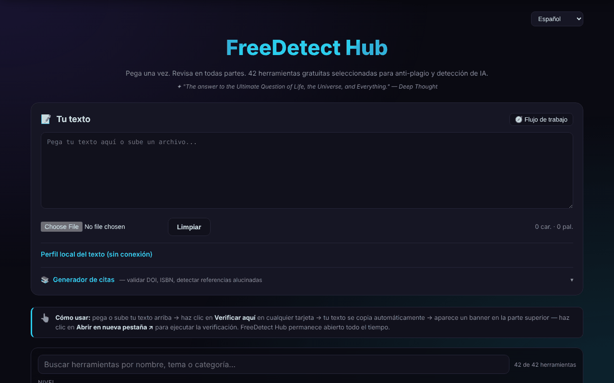

# FreeDetect Hub

[English](README.md) · [Română](README.ro.md) · [Français](README.fr.md) · [Italiano](README.it.md) · **Español** · [Português](README.pt.md) · [Deutsch](README.de.md) · [Magyar](README.hu.md)

**Versión:** 2.1.0 · **Última actualización:** 2026-10-27

**Estado:** estable · **Offline:** requiere Internet para el generador de citas, el análisis/comprobación de DOI (Crossref, OpenLibrary, doi.org) y las herramientas externas

Un panel único para 42 herramientas gratuitas de detección de plagio y de texto generado por IA, además de un generador de citas.

**Aplicación en línea:** https://chiuta.github.io/FreeDetect/

## Qué es

FreeDetect Hub («Paste once. Check everywhere.») es una aplicación HTML en un único archivo (con las bibliotecas PDF y DOCX incluidas en el directorio `vendor/`). Pegas o subes un texto una sola vez y luego eliges de una cuadrícula de 42 herramientas externas seleccionadas a mano; el texto se copia al portapapeles y la herramienta elegida se abre en una pestaña nueva, donde lo pegas.

La aplicación no realiza la verificación por sí misma: es un catálogo y una ayuda para el flujo de trabajo. Los resultados de los detectores pueden ser erróneos (falsos positivos), sobre todo en textos que no están en inglés, incluido el rumano; la aplicación lo advierte de forma explícita.

## Funciones

- Área de texto «Your Text» para pegar directamente o subir archivos `.txt`, `.md`, `.docx`, `.pdf`.
- Cuadrícula de herramientas con filtros por nivel (Tier: principiantes / profesionales) y por categoría (IA, plagio, bibliografía, imagen, etc.).
- Botón «Check here» en cada herramienta: copia el texto al portapapeles y muestra un banner con «Open in new tab».
- Búsqueda en el catálogo (nombre, tema, categoría; se ignoran los signos diacríticos), con un contador «n de 42» y un mensaje claro cuando no hay resultados; Escape vacía la búsqueda.
- «Perfil local del texto (sin conexión)»: palabras, frases, longitud media y su variación, variedad del vocabulario, tiempo de lectura, DOI encontrados y expresiones de tres palabras repetidas. Son estadísticas descriptivas, no una prueba de plagio ni de texto generado por IA (la advertencia se muestra en el panel). Los textos nuevos de la búsqueda y del perfil están traducidos al rumano y al inglés; en los demás idiomas aparecen en inglés.
- Panel «Workflow» (flujo recomendado en 7 pasos) y botón «Clear».
- Generador de citas: introduces un DOI, ISBN o URL, «Fetch» comprueba localmente el dígito de control del ISBN, obtiene los metadatos de Crossref / OpenLibrary y produce APA, MLA, Chicago o BibTeX, con «Copy».
- «Scan input text»: encuentra los DOI del texto y los comprueba en Crossref, para señalar referencias posiblemente inventadas.
- Interfaz en 15 idiomas (selector 🌐): inglés, rumano, francés, alemán, español, portugués, italiano, neerlandés, polaco, ruso, árabe, chino, japonés, coreano, turco.
- Páginas de privacidad/RGPD, cookies y aviso legal, enlaces de Buy Me a Coffee.

## Novedades (1.1.0)

- **Comprobación de datos personales antes de «Check here»**: el texto se analiza localmente; si aparecen correos electrónicos, teléfonos, IBAN, CNP (números de identificación personal rumanos), etc., puedes enmascarar, continuar o cancelar. Solo se enmascara el texto copiado al portapapeles; el área de texto permanece sin cambios.
- **Búsqueda en el catálogo por relevancia**, con sinónimos (plagiat/plagiarism, AI/GPT, citare, etc.) y tolerancia a errores; junto al contador aparece «· după relevanță» (por relevancia). La antigua coincidencia literal se mantiene.
- **«Export profile (.md)»**: guarda el perfil local del texto como archivo Markdown (estadísticas, no el texto).
- Se incluyen los módulos comunes «fff-kit»; la copia `.fff.json` del cuadro de diálogo de la versión contiene solo el idioma de la interfaz.
- Los textos nuevos están en los 15 idiomas de la interfaz; **las traducciones no han sido verificadas por hablantes nativos.**

## Guía de uso

1. Abre la página y, si quieres, cambia el idioma con el selector 🌐 (la elección se recuerda).
2. Pega el texto en «Your Text» o sube un archivo `.txt`, `.md`, `.docx` o `.pdf`.
3. Usa los filtros Tier y Category para acotar la cuadrícula de herramientas.
4. Pulsa «Check here» en 2–3 detectores; el texto se copia automáticamente al portapapeles.
5. En el banner que aparece pulsa «Open in new tab» y luego pega el texto (Ctrl+V / Cmd+V) en la herramienta abierta.
6. Compara los resultados: una sola señal no es una prueba.
7. Para las referencias: abre «Citation Generator», introduce un DOI/ISBN y pulsa «Fetch», o pulsa «Scan input text» para comprobar los DOI del texto.
8. «Clear» vacía el área de texto.

Teclado: Intro en el campo del generador de citas lo ejecuta; Escape en el campo de búsqueda lo vacía; no hay otros atajos.

## Privacidad y red

- Local: en `localStorage` solo se conserva el idioma de la interfaz (`freedetect.lang`). Tu texto no se guarda.
- La aplicación no envía a ninguna parte el texto pegado. Las únicas solicitudes de red de la página son las del generador de citas, cuando se acciona: `api.crossref.org` (DOI y análisis) y `openlibrary.org` (ISBN).
- Las solicitudes a Crossref contienen el DOI consultado, tu dirección IP y el parámetro `mailto=alexio@trom.tf` (la dirección de contacto del autor, usada para el «polite pool»); las dirigidas a OpenLibrary contienen el ISBN y la IP. «Scan input text» envía a Crossref solo los DOI encontrados en el texto, no el texto completo.
- Cuando usas «Check here», el texto llega, mediante tu pegado, al servicio de terceros elegido y queda sujeto a su política.
- La página contiene enlaces (no solicitudes automáticas) a decenas de servicios de terceros, a Buy Me a Coffee y a los sitios del autor.

## Advertencia

Las herramientas listadas son servicios de terceros; los resultados de los detectores de plagio y de texto generado por IA pueden ser erróneos (falsos positivos), sobre todo para el rumano, y no constituyen una prueba. El catálogo incluye también herramientas de tipo «humanizer»/paráfrasis, listadas como tales, sin recomendar eludir las normas de integridad académica. Las marcas pertenecen a sus propietarios (nombres comerciales de sus titulares, usados con fines descriptivos). Las herramientas «humanizer» se mantienen en el catálogo solo como información sobre lo que existe en el mercado; el autor no las recomienda para eludir las normas de integridad académica, y su uso en trabajos sujetos a esas normas sigue siendo responsabilidad del usuario.

## Ejecución local / sin conexión

Descarga el repositorio (el archivo `index.html` y el directorio `vendor/`) y abre `index.html` en un navegador. La interfaz, el filtrado y la lectura de archivos locales funcionan sin internet. Necesitan internet: el generador de citas (Crossref, OpenLibrary) y, por supuesto, las herramientas externas que abras.

## Licencia

MIT, según la cabecera de la aplicación — véase el archivo LICENSE. Atención: el directorio `vendor/` contiene bibliotecas de terceros con sus propias licencias, que no quedan cubiertas por la licencia MIT — `pdfjs/` (Mozilla pdf.js 3.x, Apache-2.0, según la cabecera del archivo) y `mammoth.browser.min.js` (mammoth.js, BSD-2-Clause según el proyecto de origen; el texto de la licencia no está incluido en el archivo). Detalles en [NOTICE.md](NOTICE.md).

## Autor

Alexio — Alexandru-Ionuț Chiuță, contacto: alexio@trom.tf

## Resumen

FreeDetect Hub es un panel HTML de un único archivo con enlaces a 42 herramientas gratuitas, seleccionadas a mano, de detección de plagio y de IA. Pega o sube un texto (.txt, .md, .docx, .pdf), haz clic en «Check here» para copiarlo al portapapeles y abrir la herramienta elegida. Incluye un generador de citas DOI/ISBN (Crossref, OpenLibrary) y un detector de referencias alucinadas. Interfaz en 15 idiomas. Solo las funciones de citas contactan con la red; solo la elección del idioma se guarda en local.

## Auditoría

Auditoría: 2026-10-10 (ronda 2, 2026-10-11: añadido NOTICE.md para los componentes de terceros; nota sobre las herramientas humanizer) — verificado: el texto pegado no sale de la página (CSP `connect-src` solo `api.crossref.org` y `openlibrary.org`); corregido un enlace sin nombre accesible (el banner «Open in new tab») y el ruido en la consola causado por `frame-ancestors` en el meta CSP (la directiva se ignora en meta; la protección frente a la inclusión en marcos exige una cabecera HTTP).

## Historial / Changelog

### 1.3.8 — 2026-10-23

- Fix: the citation generator no longer reports “no connection” for valid but incomplete Crossref/Open Library responses (missing date, nameless authors, empty publishers); CSP hash recalculated.

### 1.3.7 — 2026-10-23

- Almacenamiento: las claves llevan ahora el prefijo de la aplicación (`freedetect.lang`); los datos existentes se migran automáticamente al iniciar desde las claves antiguas (`fdh_lang`) y las copias `.fff.json` antiguas se siguen importando (fff-kit 1.2.0).

### 1.3.5 — 2026-10-22

fff-kit 1.1.4: áreas táctiles y texto mínimo. Áreas táctiles/texto corregidos en la aplicación.

### 1.3.4 — 2026-10-22

fff-kit 1.1.2: PBKDF2 con 600.000 iteraciones, protección anti-clickjacking.

### 1.3.3 — 2026-10-22
- Legibilidad en móvil: las etiquetas de las herramientas y del perfil pasan de 10–11 px a 12 px; los enlaces del pie, el resumen «perfil local» y el campo de archivo tienen ahora áreas táctiles de al menos 24 px.

### 1.3.2 — 2026-10-22
- Corrección de traducción: los paneles legales (privacidad/RGPD, cookies, aviso legal, términos, accesibilidad, tecnología) se han traducido por completo al italiano y al portugués, el aviso de JavaScript desactivado aparece en los 8 idiomas y «Impressum» pasa a «Aviso legal» en portugués.

### 14 de octubre de 2026 (v1.1.0)
- Protección de datos personales antes de copiar al portapapeles (FFF.pii).
- Búsqueda en el catálogo por relevancia, con sinónimos (FFF.search).
- Exportación del perfil (.md). Módulos comunes core, label, bundle, search, pii; pruebas: `tests/fff-r8.test.mjs`.

### 12 de octubre de 2026 (v1.0.0)
- 1.0.0 — 2026-10-12: la versión y la fecha de la última actualización se muestran en la aplicación

### 11 de octubre de 2026
- El contador de palabras bajo el texto y «Cuvinte» (Palabras) del perfil local usan ahora la misma regla de recuento (antes: 33 frente a 35 para el mismo texto).
- El generador de citas comprueba localmente el dígito de control del ISBN (ISBN-10 e ISBN-13) antes de cualquier solicitud: un ISBN erróneo recibe un mensaje inmediato, sin red, en los 15 idiomas.
- El selector de idioma se ha movido a un landmark (`header`): 0 violaciones de axe, incluida `region`.
- El mensaje de error sin red del generador de citas es ahora explícito, en los 15 idiomas (antes: «Failed to fetch»).
- Los 18 atributos `onclick` del HTML se han sustituido por atributos `data-*` y un escuchador delegado.
- Las fechas de «Última actualización» de las páginas legales: octubre de 2026.
- Búsqueda en el catálogo de 42 herramientas (con un estado vacío explícito) y panel «Perfil local del texto» con estadísticas descriptivas sin conexión (frases, variación, vocabulario, DOI, expresiones repetidas); textos nuevos en rumano e inglés.
- CSP: `script-src` mediante hash SHA-256 en lugar de `'unsafe-inline'`.
