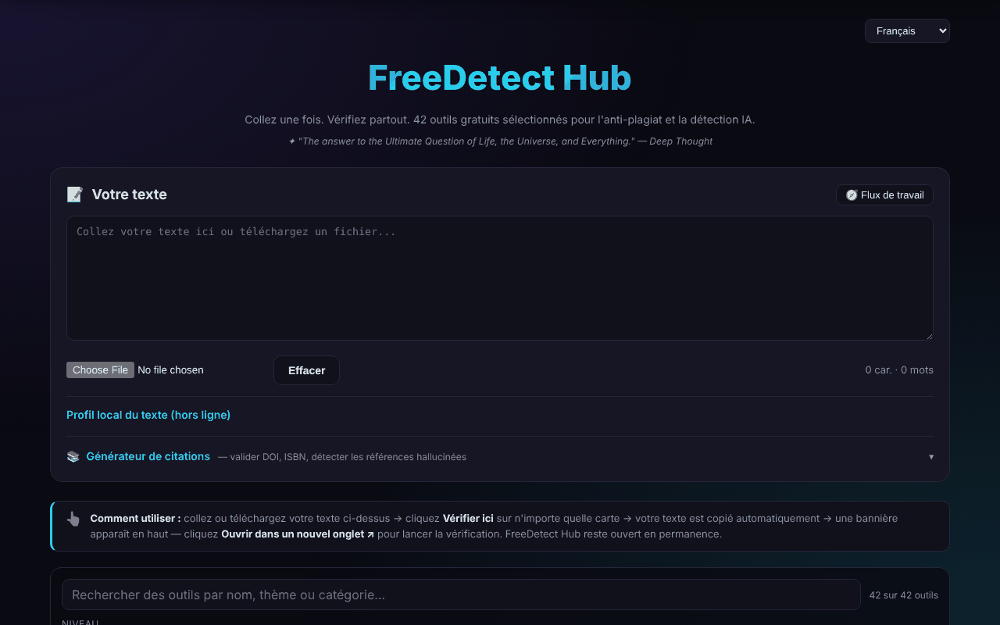

# FreeDetect Hub

[English](README.md) · [Română](README.ro.md) · **Français** · [Italiano](README.it.md) · [Español](README.es.md) · [Português](README.pt.md) · [Deutsch](README.de.md) · [Magyar](README.hu.md)

**Version :** 2.1.0 · **Dernière mise à jour :** 2026-10-27

**Statut:** stable · **Offline:** nécessite Internet pour le générateur de citations, l'analyse/vérification des DOI (Crossref, OpenLibrary, doi.org) et les outils externes

Un panneau unique pour 42 outils gratuits de détection du plagiat et des textes générés par l'IA, plus un générateur de citations.

**Application en ligne :** https://chiuta.github.io/FreeDetect/

## Présentation

FreeDetect Hub (« Paste once. Check everywhere. ») est une application HTML dans un seul fichier (avec les bibliothèques PDF et DOCX incluses dans le répertoire `vendor/`). Vous collez ou téléversez un texte une seule fois, puis vous choisissez dans une grille de 42 outils externes sélectionnés à la main ; le texte est copié dans le presse-papiers et l'outil choisi s'ouvre dans un nouvel onglet, où vous le collez.

L'application ne fait pas la vérification elle-même : c'est un catalogue et une aide au flux de travail. Les résultats des détecteurs peuvent être erronés (faux positifs), surtout pour les textes non anglophones, y compris le roumain ; l'application en avertit explicitement.

## Fonctionnalités

- Zone de texte « Your Text » pour coller directement ou téléverser des fichiers `.txt`, `.md`, `.docx`, `.pdf`.
- Grille d'outils avec filtres par niveau (Tier : débutants / professionnels) et par catégorie (IA, plagiat, bibliographie, image, etc.).
- Bouton « Check here » sur chaque outil : il copie le texte dans le presse-papiers et affiche un bandeau avec « Open in new tab ».
- Recherche dans le catalogue (nom, thème, catégorie ; les signes diacritiques sont ignorés), avec un compteur « n sur 42 » et un message clair quand il n'y a aucun résultat ; Échap vide la recherche.
- « Profil local du texte (hors ligne) » : mots, phrases, longueur moyenne et sa variation, variété du vocabulaire, temps de lecture, DOI trouvés et expressions de trois mots répétées. Ce sont des statistiques descriptives, non un test de plagiat ou de texte généré par l'IA (l'avertissement est affiché dans le panneau). Les nouveaux textes de la recherche et du profil sont traduits en roumain et en anglais ; dans les autres langues, ils apparaissent en anglais.
- Panneau « Workflow » (flux recommandé en 7 étapes) et bouton « Clear ».
- Générateur de citations : vous saisissez un DOI, un ISBN ou une URL, « Fetch » vérifie localement la clé de contrôle de l'ISBN, récupère les métadonnées auprès de Crossref / OpenLibrary et produit du APA, MLA, Chicago ou BibTeX, avec « Copy ».
- « Scan input text » : repère les DOI dans le texte et les vérifie auprès de Crossref, afin de signaler des références possiblement inventées.
- Interface en 15 langues (sélecteur 🌐) : anglais, roumain, français, allemand, espagnol, portugais, italien, néerlandais, polonais, russe, arabe, chinois, japonais, coréen, turc.
- Pages de confidentialité/RGPD, de cookies et de mentions légales, liens Buy Me a Coffee.

## Nouveautés (1.1.0)

- **Vérification des données personnelles avant « Check here »** : le texte est analysé localement ; si des e-mails, téléphones, IBAN, CNP (numéros d'identification personnels roumains), etc. apparaissent, vous pouvez masquer, continuer ou annuler. Seul le texte copié dans le presse-papiers est masqué ; la zone de texte reste inchangée.
- **Recherche dans le catalogue par pertinence**, avec synonymes (plagiat/plagiarism, AI/GPT, citare, etc.) et tolérance aux fautes ; « · după relevanță » (par pertinence) apparaît à côté du compteur. L'ancienne correspondance littérale demeure.
- **« Export profile (.md) »** : enregistre le profil local du texte sous forme de fichier Markdown (statistiques, pas le texte).
- Les modules communs « fff-kit » sont inclus ; la copie `.fff.json` de la boîte de dialogue de la version ne contient que la langue de l'interface.
- Les nouveaux textes sont dans les 15 langues de l'interface ; **les traductions n'ont pas été vérifiées par des locuteurs natifs.**

## Mode d'emploi

1. Ouvrez la page et, si vous le souhaitez, changez de langue avec le sélecteur 🌐 (le choix est mémorisé).
2. Collez le texte dans « Your Text » ou téléversez un fichier `.txt`, `.md`, `.docx` ou `.pdf`.
3. Utilisez les filtres Tier et Category pour restreindre la grille d'outils.
4. Appuyez sur « Check here » pour 2 ou 3 détecteurs ; le texte est copié automatiquement dans le presse-papiers.
5. Dans le bandeau qui apparaît, appuyez sur « Open in new tab », puis collez le texte (Ctrl+V / Cmd+V) dans l'outil ouvert.
6. Comparez les résultats : un seul signal n'est pas une preuve.
7. Pour les références : ouvrez « Citation Generator », saisissez un DOI/ISBN et appuyez sur « Fetch », ou appuyez sur « Scan input text » pour vérifier les DOI du texte.
8. « Clear » vide la zone de texte.

Clavier : Entrée dans le champ du générateur de citations le lance ; Échap dans le champ de recherche le vide ; il n'y a pas d'autres raccourcis.

## Confidentialité et réseau

- En local : seule la langue de l'interface (`freedetect.lang`) est conservée dans `localStorage`. Votre texte n'est pas enregistré.
- Le texte collé n'est envoyé nulle part par l'application. Les seules requêtes réseau de la page sont celles du générateur de citations, lorsqu'on l'utilise : `api.crossref.org` (DOI et analyse) et `openlibrary.org` (ISBN).
- Les requêtes vers Crossref contiennent le DOI interrogé, votre adresse IP et le paramètre `mailto=alexio@trom.tf` (l'adresse de contact de l'auteur, utilisée pour le « polite pool ») ; celles vers OpenLibrary contiennent l'ISBN et l'IP. « Scan input text » n'envoie à Crossref que les DOI trouvés dans le texte, pas le texte entier.
- Quand vous utilisez « Check here », le texte parvient, par votre collage, au service tiers choisi et relève de sa politique.
- La page contient des liens (pas de requêtes automatiques) vers des dizaines de services tiers, vers Buy Me a Coffee et vers les sites de l'auteur.

## Avertissement

Les outils répertoriés sont des services tiers ; les résultats des détecteurs de plagiat et de texte généré par l'IA peuvent être erronés (faux positifs), surtout pour le roumain, et ne constituent pas une preuve. Le catalogue inclut aussi des outils de type « humanizer »/paraphrase, répertoriés comme tels, sans recommander de contourner les règles d'intégrité académique. Les marques appartiennent à leurs propriétaires (noms commerciaux de leurs titulaires, utilisés à titre descriptif). Les outils « humanizer » ne sont conservés dans le catalogue qu'à titre d'information sur ce qui existe sur le marché ; l'auteur ne les recommande pas pour contourner les règles d'intégrité académique, et leur utilisation dans des travaux soumis à ces règles reste de la responsabilité de l'utilisateur.

## Exécution en local / hors ligne

Téléchargez le dépôt (le fichier `index.html` et le répertoire `vendor/`) et ouvrez `index.html` dans un navigateur. L'interface, le filtrage et la lecture des fichiers locaux fonctionnent sans internet. Ont besoin d'internet : le générateur de citations (Crossref, OpenLibrary) et, bien sûr, les outils externes que vous ouvrez.

## Licence

MIT, selon l'en-tête de l'application — voir le fichier LICENSE. Attention : le répertoire `vendor/` contient des bibliothèques tierces avec leurs propres licences, qui ne sont pas couvertes par la licence MIT — `pdfjs/` (Mozilla pdf.js 3.x, Apache-2.0, selon l'en-tête du fichier) et `mammoth.browser.min.js` (mammoth.js, BSD-2-Clause selon le projet source ; le texte de la licence n'est pas inclus dans le fichier). Détails dans [NOTICE.md](NOTICE.md).

## Auteur

Alexio — Alexandru-Ionuț Chiuță, contact : alexio@trom.tf

## Résumé

FreeDetect Hub est un tableau de bord HTML en un seul fichier qui renvoie vers 42 outils gratuits de détection de plagiat et d'IA, choisis un à un. Collez ou téléversez un texte (.txt, .md, .docx, .pdf), cliquez sur « Check here » pour le copier dans le presse-papiers et ouvrir l'outil choisi. Il comprend un générateur de citations DOI/ISBN (Crossref, OpenLibrary) et un détecteur de références hallucinées. Interface en 15 langues. Seules les fonctions de citation contactent le réseau ; seul le choix de la langue est stocké localement.

## Audit

Audit : 2026-10-10 (tour 2, 2026-10-11 : NOTICE.md ajouté pour les composants tiers ; note sur les outils humanizer) — vérifié : le texte collé ne quitte pas la page (CSP `connect-src` uniquement `api.crossref.org` et `openlibrary.org`) ; correction d'un lien sans nom accessible (le bandeau « Open in new tab ») et du bruit dans la console causé par `frame-ancestors` dans la balise meta CSP (la directive est ignorée dans meta ; la protection contre l'inclusion en cadre exige un en-tête HTTP).

## Historique / Changelog

### 1.3.8 — 2026-10-23

- Fix: the citation generator no longer reports “no connection” for valid but incomplete Crossref/Open Library responses (missing date, nameless authors, empty publishers); CSP hash recalculated.

### 1.3.7 — 2026-10-23

- Stockage : les clés portent désormais le préfixe de l'application (`freedetect.lang`) ; les données existantes sont migrées automatiquement au démarrage depuis les anciennes clés (`fdh_lang`), et les anciennes sauvegardes `.fff.json` s'importent toujours (fff-kit 1.2.0).

### 1.3.5 — 2026-10-22

fff-kit 1.1.4 : cibles tactiles et taille de texte minimale. Cibles tactiles/texte corrigés dans l’application.

### 1.3.4 — 2026-10-22

fff-kit 1.1.2 : PBKDF2 600 000 itérations, protection anti-clickjacking.

### 1.3.3 — 2026-10-22
- Lisibilité sur mobile : les étiquettes des outils et du profil passent de 10–11 px à 12 px ; les liens du pied de page, le résumé « profil local » et le champ fichier ont désormais des cibles tactiles d'au moins 24 px.

### 1.3.2 — 2026-10-22
- Correction de traduction : les panneaux juridiques (confidentialité/RGPD, cookies, mentions légales, conditions, accessibilité, technologie) sont entièrement traduits en italien et en portugais, l'avertissement JavaScript désactivé figure dans les 8 langues et « Impressum » devient « Aviso legal » en portugais.

### 14 octobre 2026 (v1.1.0)
- Protection des données personnelles avant la copie dans le presse-papiers (FFF.pii).
- Recherche dans le catalogue par pertinence, avec synonymes (FFF.search).
- Export du profil (.md). Modules communs core, label, bundle, search, pii ; tests : `tests/fff-r8.test.mjs`.

### 12 octobre 2026 (v1.0.0)
- 1.0.0 — 2026-10-12 : la version et la date de la dernière mise à jour sont affichées dans l'application

### 11 octobre 2026
- Le compteur de mots sous le texte et « Cuvinte » (Mots) du profil local utilisent désormais la même règle de comptage (avant : 33 contre 35 pour le même texte).
- Le générateur de citations vérifie localement la clé de contrôle de l'ISBN (ISBN-10 et ISBN-13) avant toute requête : un ISBN erroné reçoit un message immédiat, sans réseau, dans les 15 langues.
- Le sélecteur de langue a été déplacé dans un repère (`header`) : 0 violation axe, y compris `region`.
- Le message d'erreur sans réseau du générateur de citations est désormais explicite, dans les 15 langues (avant : « Failed to fetch »).
- Les 18 attributs `onclick` du HTML ont été remplacés par des attributs `data-*` et un écouteur délégué.
- Les dates « Dernière mise à jour » des pages légales : octobre 2026.
- Recherche dans le catalogue de 42 outils (avec un état vide explicite) et panneau « Profil local du texte » avec statistiques descriptives hors ligne (phrases, variation, vocabulaire, DOI, expressions répétées) ; nouveaux textes en roumain et en anglais.
- CSP : `script-src` par hachage SHA-256 au lieu de `'unsafe-inline'`.
