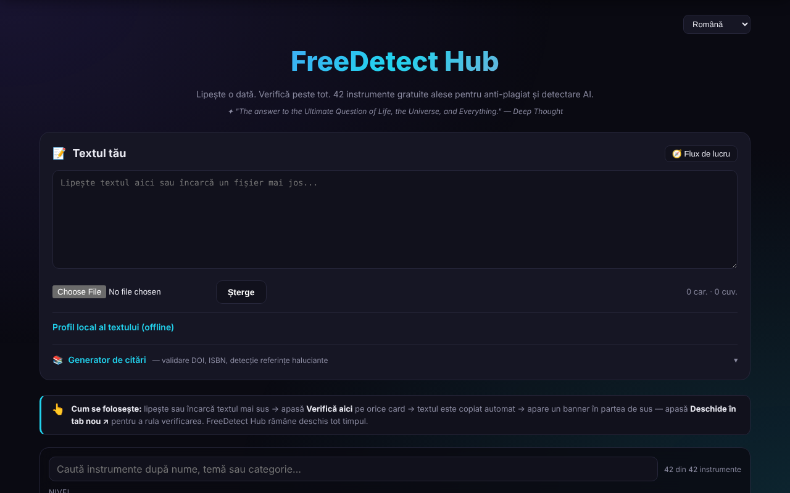

# FreeDetect Hub

[English](README.md) · [Română](README.ro.md) · [Français](README.fr.md) · [Italiano](README.it.md) · [Español](README.es.md) · [Português](README.pt.md) · [Deutsch](README.de.md) · **Magyar**

**Verzió:** 1.2.0 · **Utolsó frissítés:** 2026-10-19

Egyetlen panel 42 ingyenes plágium- és MI-generált szöveg felismerő eszközhöz, plusz egy hivatkozásgenerátor.

**Online alkalmazás:** https://chiuta.github.io/FreeDetect/

## Mi ez

A FreeDetect Hub („Paste once. Check everywhere.”) egyetlen fájlból álló HTML-alkalmazás (a PDF- és DOCX-könyvtárak a `vendor/` könyvtárban találhatók). Egyszer beillesztesz vagy feltöltesz egy szöveget, majd kiválasztasz egyet a 42 kézzel válogatott külső eszköz rácsából; a szöveg a vágólapra másolódik, a kiválasztott eszköz pedig új lapon nyílik meg, ahová beilleszted.

Az alkalmazás maga nem végzi el az ellenőrzést: katalógus és munkafolyamat-segéd. A felismerők eredményei tévesek lehetnek (hamis pozitívok), különösen a nem angol nyelvű, így a román szövegeknél is; az alkalmazás kifejezetten figyelmeztet erre.

## Funkciók

- „Your Text” szövegterület közvetlen beillesztéshez vagy `.txt`, `.md`, `.docx`, `.pdf` fájlok feltöltéséhez.
- Eszközrács szűrőkkel szint (Tier: kezdők / profik) és kategória (MI, plágium, bibliográfia, kép stb.) szerint.
- „Check here” gomb minden eszközön: a szöveget a vágólapra másolja, és „Open in new tab” feliratú szalagot jelenít meg.
- Keresés a katalógusban (név, téma, kategória; az ékezeteket figyelmen kívül hagyja), „n a 42-ből” számlálóval és világos üzenettel, ha nincs találat; az Escape törli a keresést.
- „A szöveg helyi profilja (offline)”: szavak, mondatok, átlagos hossz és annak ingadozása, szókincs-változatosság, olvasási idő, talált DOI-k és ismétlődő háromszavas kifejezések. Ezek leíró statisztikák, nem plágium- vagy MI-generált szöveg tesztek (a figyelmeztetés a panelen látható). A keresés és a profil új szövegei románra és angolra vannak lefordítva; a többi nyelven angolul jelennek meg.
- „Workflow” panel (ajánlott 7 lépéses folyamat) és „Clear” gomb.
- Hivatkozásgenerátor: megadsz egy DOI-t, ISBN-t vagy URL-t, a „Fetch” helyben ellenőrzi az ISBN ellenőrző számjegyét, lekéri a metaadatokat a Crossreftől / OpenLibrarytől, és APA, MLA, Chicago vagy BibTeX formátumot állít elő, „Copy” gombbal.
- „Scan input text”: megkeresi a szövegben a DOI-kat, és ellenőrzi őket a Crossrefnél, hogy jelezze a feltehetően kitalált hivatkozásokat.
- Felület 15 nyelven (🌐 választó): angol, román, francia, német, spanyol, portugál, olasz, holland, lengyel, orosz, arab, kínai, japán, koreai, török.
- Adatvédelmi/GDPR-, süti- és impresszum-oldalak, Buy Me a Coffee hivatkozások.

## Újdonságok (1.1.0)

- **Személyes adatok ellenőrzése a „Check here” előtt**: a szöveget helyben vizsgálja; ha e-mail-címek, telefonszámok, IBAN-ok, CNP-k (román személyi azonosító számok) stb. szerepelnek benne, maszkolhatsz, folytathatod vagy megszakíthatod. Csak a vágólapra másolt szöveg maszkolódik; a szövegterület változatlan marad.
- **Keresés a katalógusban relevancia szerint**, szinonimákkal (plagiat/plagiarism, AI/GPT, citare stb.) és elírás-tűréssel; a számláló mellett megjelenik a „· după relevanță” (relevancia szerint) felirat. A régi szó szerinti egyezés megmarad.
- **„Export profile (.md)”**: a szöveg helyi profilját Markdown-fájlként menti (statisztikák, nem a szöveg).
- A közös „fff-kit” modulok mellékelve vannak; a verzió-párbeszédablakból származó `.fff.json` másolat csak a felület nyelvét tartalmazza.
- Az új szövegek a felület mind a 15 nyelvén megvannak; **a fordításokat anyanyelvi beszélők nem ellenőrizték.**

## Használati útmutató

1. Nyisd meg az oldalt, és ha szeretnéd, váltsd a nyelvet a 🌐 választóval (a választás megmarad).
2. Illeszd be a szöveget a „Your Text” mezőbe, vagy tölts fel egy `.txt`, `.md`, `.docx` vagy `.pdf` fájlt.
3. A Tier és Category szűrőkkel szűkítsd az eszközrácsot.
4. Nyomd meg a „Check here” gombot 2–3 felismerőnél; a szöveg automatikusan a vágólapra másolódik.
5. A megjelenő szalagon nyomd meg az „Open in new tab” gombot, majd illeszd be a szöveget (Ctrl+V / Cmd+V) a megnyitott eszközbe.
6. Hasonlítsd össze az eredményeket: egyetlen jel nem bizonyíték.
7. Hivatkozásokhoz: nyisd meg a „Citation Generator” részt, add meg a DOI-t/ISBN-t, és nyomd meg a „Fetch” gombot, vagy nyomd meg a „Scan input text” gombot a szövegben lévő DOI-k ellenőrzéséhez.
8. A „Clear” kiüríti a szövegterületet.

Billentyűzet: az Enter a hivatkozásgenerátor mezőjében futtatja azt; az Escape a keresőmezőben törli; más billentyűparancs nincs.

## Adatvédelem és hálózat

- Helyben: a `localStorage`-ban csak a felület nyelve (`fdh_lang`) tárolódik. A szöveged nem mentődik.
- A beillesztett szöveget az alkalmazás sehová nem küldi el. Az oldal egyetlen hálózati kérései a hivatkozásgenerátoréi, használatakor: `api.crossref.org` (DOI és vizsgálat) és `openlibrary.org` (ISBN).
- A Crossrefnek küldött kérések tartalmazzák a lekérdezett DOI-t, az IP-címedet és a `mailto=alexio@trom.tf` paramétert (a szerző elérhetőségi címe, a „polite pool” használatához); az OpenLibrarynek küldöttek az ISBN-t és az IP-t. A „Scan input text” a Crossrefnek csak a szövegben talált DOI-kat küldi el, nem a teljes szöveget.
- Amikor a „Check here” funkciót használod, a szöveg a te beillesztésed révén jut el a kiválasztott harmadik fél szolgáltatásához, és annak szabályzata vonatkozik rá.
- Az oldal hivatkozásokat (nem automatikus kéréseket) tartalmaz tucatnyi harmadik fél szolgáltatásához, a Buy Me a Coffee-hoz és a szerző oldalaihoz.

## Felelősségkizárás

A felsorolt eszközök harmadik felek szolgáltatásai; a plágium- és MI-generált szöveg felismerők eredményei tévesek lehetnek (hamis pozitívok), különösen román nyelvnél, és nem képeznek bizonyítékot. A katalógus „humanizer”/parafrazáló típusú eszközöket is tartalmaz, ekként felsorolva, az akadémiai integritás szabályainak megkerülésére vonatkozó ajánlás nélkül. A védjegyek a tulajdonosaikat illetik (birtokosaik kereskedelmi nevei, leíró jelleggel használva). A „humanizer” eszközök csak a piacon létezőkről szóló tájékoztatásként maradnak a katalógusban; a szerző nem ajánlja őket az akadémiai integritás szabályainak megkerülésére, és ezek használata az ilyen szabályok hatálya alá eső munkákban a felhasználó felelőssége marad.

## Helyi / offline futtatás

Töltsd le a tárolót (az `index.html` fájlt és a `vendor/` könyvtárat), és nyisd meg az `index.html` fájlt egy böngészőben. A felület, a szűrés és a helyi fájlok olvasása internet nélkül is működik. Internetet igényel: a hivatkozásgenerátor (Crossref, OpenLibrary), és természetesen a külső eszközök, amelyeket megnyitsz.

## Licenc

MIT, az alkalmazás fejléce szerint — lásd a LICENSE fájlt. Figyelem: a `vendor/` könyvtár harmadik féltől származó, saját licenccel rendelkező könyvtárakat tartalmaz, amelyekre az MIT licenc nem terjed ki — `pdfjs/` (Mozilla pdf.js 3.x, Apache-2.0, a fájl fejléce szerint) és `mammoth.browser.min.js` (mammoth.js, BSD-2-Clause a forrásprojekt szerint; a licencszöveg nincs a fájlban). Részletek a [NOTICE.md](NOTICE.md) fájlban.

## Szerző

Alexio — Alexandru-Ionuț Chiuță, elérhetőség: alexio@trom.tf

## Összefoglaló
A FreeDetect Hub egyfájlos HTML-irányítópult, amely 42 kézzel válogatott ingyenes plágium- és MI-felismerő eszközre mutat. Illessz be vagy tölts fel szöveget (.txt, .md, .docx, .pdf), kattints a „Check here” gombra, hogy a vágólapra másolja, és megnyissa a kiválasztott eszközt. Tartalmaz DOI/ISBN hivatkozásgenerátort (Crossref, OpenLibrary) és hallucinált hivatkozásokat kereső ellenőrzőt. Felület 15 nyelven. Csak a hivatkozásfunkciók érik el a hálózatot; helyben csak a nyelvválasztás tárolódik.

## Audit

Audit: 2026-10-10 (2. kör, 2026-10-11: a harmadik féltől származó komponensekhez hozzáadva a NOTICE.md; megjegyzés a humanizer eszközökről) — ellenőrizve: a beillesztett szöveg nem hagyja el az oldalt (CSP `connect-src` csak `api.crossref.org` és `openlibrary.org`); javítva egy hozzáférhető név nélküli hivatkozás (az „Open in new tab” szalag) és a konzolzaj, amelyet a CSP meta címkében lévő `frame-ancestors` okozott (az irányelvet a meta címke figyelmen kívül hagyja; a keretbe ágyazás elleni védelemhez HTTP-fejléc kell).

## Előzmények / Changelog

### 2026. október 14. (v1.1.0)
- Személyes adatok védelme a vágólapra másolás előtt (FFF.pii).
- Keresés a katalógusban relevancia szerint, szinonimákkal (FFF.search).
- Profilexport (.md). Közös modulok: core, label, bundle, search, pii; tesztek: `tests/fff-r8.test.mjs`.

### 2026. október 12. (v1.0.0)
- 1.0.0 — 2026-10-12: a verzió és az utolsó frissítés dátuma megjelenik az alkalmazásban

### 2026. október 11.
- A szöveg alatti szószámláló és a helyi profil „Cuvinte” (Szavak) értéke most ugyanazt a számlálási szabályt használja (korábban: 33 helyett 35 ugyanarra a szövegre).
- A hivatkozásgenerátor minden kérés előtt helyben ellenőrzi az ISBN ellenőrző számjegyét (ISBN-10 és ISBN-13): a hibás ISBN azonnal üzenetet kap, hálózat nélkül, mind a 15 nyelven.
- A nyelvválasztó egy tájékozódási pontba (`header`) került: 0 axe-szabálysértés, a `region` is beleértve.
- A hivatkozásgenerátor hálózat nélküli hibaüzenete most egyértelmű, mind a 15 nyelven (korábban: „Failed to fetch”).
- A HTML 18 `onclick` attribútumát `data-*` attribútumok és egy delegált eseményfigyelő váltotta fel.
- Az „Utolsó frissítés” dátumok a jogi oldalakon: 2026. október.
- Keresés a 42 eszközös katalógusban (kifejezett üres állapottal) és „A szöveg helyi profilja” panel offline leíró statisztikákkal (mondatok, ingadozás, szókincs, DOI-k, ismétlődő kifejezések); új szövegek románul és angolul.
- CSP: `script-src` SHA-256 hash-sel az `'unsafe-inline'` helyett.
