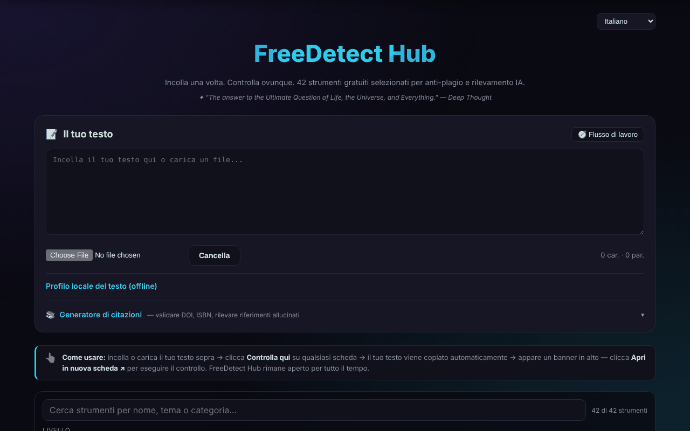

# FreeDetect Hub

[English](README.md) · [Română](README.ro.md) · [Français](README.fr.md) · **Italiano** · [Español](README.es.md) · [Português](README.pt.md) · [Deutsch](README.de.md) · [Magyar](README.hu.md)

**Versione:** 1.3.7 · **Ultimo aggiornamento:** 2026-10-23

Un pannello unico per 42 strumenti gratuiti di rilevamento del plagio e dei testi generati dall'IA, più un generatore di citazioni.

**App online:** https://chiuta.github.io/FreeDetect/

## Che cos'è

FreeDetect Hub («Paste once. Check everywhere.») è un'applicazione HTML in un unico file (con le librerie PDF e DOCX incluse nella directory `vendor/`). Incolli o carichi un testo una sola volta, poi scegli da una griglia di 42 strumenti esterni selezionati a mano; il testo viene copiato negli appunti e lo strumento scelto si apre in una nuova scheda, dove lo incolli.

L'app non esegue la verifica in sé: è un catalogo e un aiuto per il flusso di lavoro. I risultati dei rilevatori possono essere errati (falsi positivi), soprattutto per i testi non inglesi, compreso il rumeno; l'app lo segnala esplicitamente.

## Funzioni

- Area di testo «Your Text» per incollare direttamente o caricare file `.txt`, `.md`, `.docx`, `.pdf`.
- Griglia di strumenti con filtri per livello (Tier: principianti / professionisti) e per categoria (IA, plagio, bibliografia, immagine ecc.).
- Pulsante «Check here» su ogni strumento: copia il testo negli appunti e mostra un banner con «Open in new tab».
- Ricerca nel catalogo (nome, tema, categoria; i segni diacritici vengono ignorati), con un contatore «n su 42» e un messaggio chiaro quando non ci sono risultati; Esc svuota la ricerca.
- «Profilo locale del testo (offline)»: parole, frasi, lunghezza media e sua variazione, varietà del vocabolario, tempo di lettura, DOI trovati ed espressioni di tre parole ripetute. Sono statistiche descrittive, non un test di plagio o di testo generato dall'IA (l'avvertenza è mostrata nel pannello). I nuovi testi della ricerca e del profilo sono tradotti in rumeno e inglese; nelle altre lingue compaiono in inglese.
- Pannello «Workflow» (flusso consigliato in 7 passi) e pulsante «Clear».
- Generatore di citazioni: inserisci un DOI, un ISBN o un URL, «Fetch» verifica localmente la cifra di controllo dell'ISBN, recupera i metadati da Crossref / OpenLibrary e produce APA, MLA, Chicago o BibTeX, con «Copy».
- «Scan input text»: trova i DOI nel testo e li verifica presso Crossref, per segnalare riferimenti possibilmente inventati.
- Interfaccia in 15 lingue (selettore 🌐): inglese, rumeno, francese, tedesco, spagnolo, portoghese, italiano, olandese, polacco, russo, arabo, cinese, giapponese, coreano, turco.
- Pagine su privacy/GDPR, cookie e note legali, link Buy Me a Coffee.

## Novità (1.1.0)

- **Controllo dei dati personali prima di «Check here»**: il testo viene scansionato localmente; se compaiono e-mail, telefoni, IBAN, CNP (codici numerici personali rumeni) ecc., puoi mascherare, continuare o annullare. Viene mascherato solo il testo copiato negli appunti; l'area di testo resta invariata.
- **Ricerca nel catalogo per rilevanza**, con sinonimi (plagiat/plagiarism, AI/GPT, citare ecc.) e tolleranza agli errori; accanto al contatore compare «· după relevanță» (per rilevanza). La vecchia corrispondenza letterale resta.
- **«Export profile (.md)»**: salva il profilo locale del testo come file Markdown (statistiche, non il testo).
- I moduli comuni «fff-kit» sono inclusi; la copia `.fff.json` dalla finestra della versione contiene solo la lingua dell'interfaccia.
- I nuovi testi sono in tutte le 15 lingue dell'interfaccia; **le traduzioni non sono state verificate da madrelingua.**

## Guida all'uso

1. Apri la pagina e, se vuoi, cambia lingua dal selettore 🌐 (la scelta viene ricordata).
2. Incolla il testo in «Your Text» o carica un file `.txt`, `.md`, `.docx` o `.pdf`.
3. Usa i filtri Tier e Category per restringere la griglia degli strumenti.
4. Premi «Check here» su 2–3 rilevatori; il testo viene copiato automaticamente negli appunti.
5. Nel banner che compare premi «Open in new tab», poi incolla il testo (Ctrl+V / Cmd+V) nello strumento aperto.
6. Confronta i risultati: un solo segnale non è una prova.
7. Per i riferimenti: apri «Citation Generator», inserisci un DOI/ISBN e premi «Fetch», oppure premi «Scan input text» per verificare i DOI nel testo.
8. «Clear» svuota l'area di testo.

Tastiera: Invio nel campo del generatore di citazioni lo avvia; Esc nel campo di ricerca lo svuota; non ci sono altre scorciatoie.

## Privacy e rete

- In locale: in `localStorage` viene conservata solo la lingua dell'interfaccia (`freedetect.lang`). Il tuo testo non viene salvato.
- Il testo incollato non viene inviato da nessuna parte dall'app. Le uniche richieste di rete della pagina sono quelle del generatore di citazioni, quando lo si usa: `api.crossref.org` (DOI e scansione) e `openlibrary.org` (ISBN).
- Le richieste a Crossref contengono il DOI interrogato, il tuo indirizzo IP e il parametro `mailto=alexio@trom.tf` (l'indirizzo di contatto dell'autore, usato per il «polite pool»); quelle a OpenLibrary contengono l'ISBN e l'IP. «Scan input text» invia a Crossref solo i DOI trovati nel testo, non il testo intero.
- Quando usi «Check here», il testo arriva, tramite il tuo incolla, al servizio di terzi scelto e ricade sotto la sua politica.
- La pagina contiene link (non richieste automatiche) a decine di servizi di terzi, a Buy Me a Coffee e ai siti dell'autore.

## Avvertenza

Gli strumenti elencati sono servizi di terzi; i risultati dei rilevatori di plagio e di testo generato dall'IA possono essere errati (falsi positivi), soprattutto per il rumeno, e non costituiscono una prova. Il catalogo include anche strumenti di tipo «humanizer»/parafrasi, elencati come tali, senza raccomandare di eludere le regole di integrità accademica. I marchi appartengono ai rispettivi proprietari (nomi commerciali dei loro titolari, usati a scopo descrittivo). Gli strumenti «humanizer» sono mantenuti nel catalogo solo a titolo informativo su ciò che esiste sul mercato; l'autore non li raccomanda per eludere le regole di integrità accademica, e il loro uso in lavori soggetti a tali regole resta responsabilità dell'utente.

## Esecuzione in locale / offline

Scarica il repository (il file `index.html` e la directory `vendor/`) e apri `index.html` in un browser. L'interfaccia, il filtraggio e la lettura dei file locali funzionano senza internet. Richiedono internet: il generatore di citazioni (Crossref, OpenLibrary) e, naturalmente, gli strumenti esterni che apri.

## Licenza

MIT, secondo l'intestazione dell'app — vedi il file LICENSE. Attenzione: la directory `vendor/` contiene librerie di terzi con le proprie licenze, non coperte dalla licenza MIT — `pdfjs/` (Mozilla pdf.js 3.x, Apache-2.0, secondo l'intestazione del file) e `mammoth.browser.min.js` (mammoth.js, BSD-2-Clause secondo il progetto di origine; il testo della licenza non è incluso nel file). Dettagli in [NOTICE.md](NOTICE.md).

## Autore

Alexio — Alexandru-Ionuț Chiuță, contatto: alexio@trom.tf

## Riepilogo

FreeDetect Hub è una dashboard HTML in un unico file con link a 42 strumenti gratuiti, scelti a mano, per il rilevamento di plagio e testi generati dall'IA. Incolla o carica un testo (.txt, .md, .docx, .pdf), fai clic su «Check here» per copiarlo negli appunti e aprire lo strumento scelto. Include un generatore di citazioni da DOI/ISBN (Crossref, OpenLibrary) e uno scanner di riferimenti allucinati. Interfaccia in 15 lingue. Solo le funzioni di citazione contattano la rete; in locale è memorizzata solo la scelta della lingua.

## Audit

Audit: 2026-10-10 (round 2, 2026-10-11: aggiunto NOTICE.md per i componenti di terzi; nota sugli strumenti humanizer) — verificato: il testo incollato non lascia la pagina (CSP `connect-src` solo `api.crossref.org` e `openlibrary.org`); corretto un link senza nome accessibile (il banner «Open in new tab») e il rumore nella console causato da `frame-ancestors` nel meta CSP (la direttiva viene ignorata nel meta; la protezione dall'inclusione in frame richiede un'intestazione HTTP).

## Cronologia / Changelog

### 1.3.7 — 2026-10-23

- Archiviazione: le chiavi ora hanno il prefisso dell'app (`freedetect.lang`); i dati esistenti vengono migrati automaticamente all'avvio dalle vecchie chiavi (`fdh_lang`) e i vecchi backup `.fff.json` si importano ancora (fff-kit 1.2.0).

### 1.3.5 — 2026-10-22

fff-kit 1.1.4: aree tattili e testo minimo. Aree tattili/testo corretti nell’app.

### 1.3.4 — 2026-10-22

fff-kit 1.1.2: PBKDF2 a 600.000 iterazioni, protezione anti-clickjacking.

### 1.3.3 — 2026-10-22
- Leggibilità su mobile: le etichette degli strumenti e del profilo passano da 10–11 px a 12 px; i link del piè di pagina, il riepilogo «profilo locale» e il campo file hanno ora aree tattili di almeno 24 px.

### 1.3.2 — 2026-10-22
- Correzione di traduzione: i pannelli legali (privacy/GDPR, cookie, note legali, termini, accessibilità, tecnologia) sono ora tradotti integralmente in italiano e portoghese, l'avviso con JavaScript disattivato è riportato in tutte e 8 le lingue e «Impressum» diventa «Aviso legal» in portoghese.

### 14 ottobre 2026 (v1.1.0)
- Protezione dei dati personali prima della copia negli appunti (FFF.pii).
- Ricerca nel catalogo per rilevanza, con sinonimi (FFF.search).
- Esportazione del profilo (.md). Moduli comuni core, label, bundle, search, pii; test: `tests/fff-r8.test.mjs`.

### 12 ottobre 2026 (v1.0.0)
- 1.0.0 — 2026-10-12: la versione e la data dell'ultimo aggiornamento sono mostrate nell'app

### 11 ottobre 2026
- Il contatore di parole sotto il testo e «Cuvinte» (Parole) nel profilo locale usano ora la stessa regola di conteggio (prima: 33 contro 35 per lo stesso testo).
- Il generatore di citazioni verifica localmente la cifra di controllo dell'ISBN (ISBN-10 e ISBN-13) prima di qualsiasi richiesta: un ISBN errato riceve un messaggio immediato, senza rete, in tutte le 15 lingue.
- Il selettore della lingua è stato spostato in un landmark (`header`): 0 violazioni axe, inclusa `region`.
- Il messaggio di errore senza rete del generatore di citazioni è ora esplicito, in tutte le 15 lingue (prima: «Failed to fetch»).
- I 18 attributi `onclick` dell'HTML sono stati sostituiti con attributi `data-*` e un listener delegato.
- Le date «Ultimo aggiornamento» nelle pagine legali: ottobre 2026.
- Ricerca nel catalogo di 42 strumenti (con stato vuoto esplicito) e pannello «Profilo locale del testo» con statistiche descrittive offline (frasi, variazione, vocabolario, DOI, espressioni ripetute); nuovi testi in rumeno e inglese.
- CSP: `script-src` tramite hash SHA-256 al posto di `'unsafe-inline'`.
