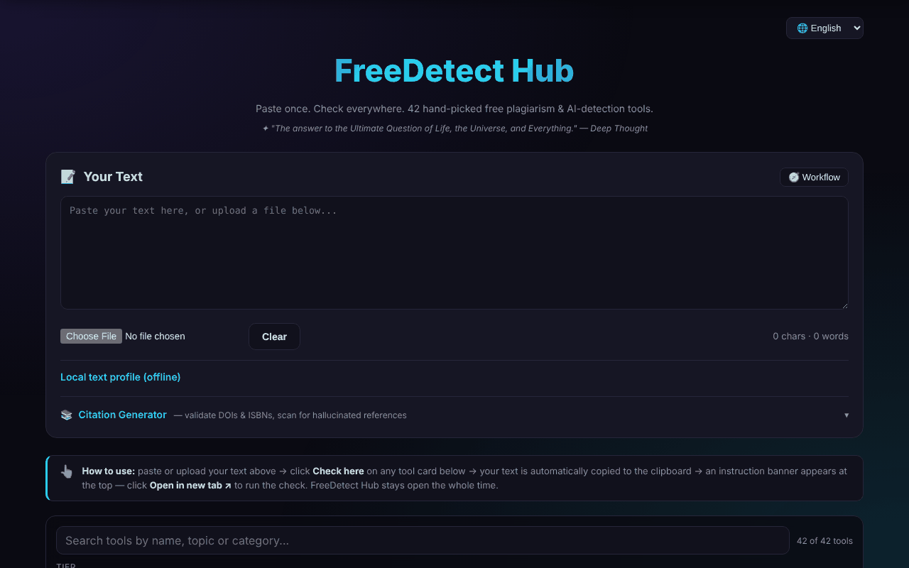

# FreeDetect Hub

**English** · [Română](README.ro.md) · [Français](README.fr.md) · [Italiano](README.it.md) · [Español](README.es.md) · [Português](README.pt.md) · [Deutsch](README.de.md) · [Magyar](README.hu.md)

**Version:** 1.3.9 · **Last updated:** 2026-10-26

A single panel for 42 free plagiarism and AI-generated text detection tools, plus a citation generator.

**Live app:** https://chiuta.github.io/FreeDetect/

## What it is

FreeDetect Hub ("Paste once. Check everywhere.") is a single-file HTML application (with the PDF and DOCX libraries included in the `vendor/` directory). You paste or upload a text once, then choose from a grid of 42 hand-picked external tools; the text is copied to the clipboard and the chosen tool opens in a new tab, where you paste it.

The app does not do the checking itself: it is a catalog and a workflow aid. The results of detectors can be wrong (false positives), especially for non-English texts, including Romanian; the app warns about this explicitly.

## Features

- "Your Text" text area for direct pasting or uploading `.txt`, `.md`, `.docx`, `.pdf` files.
- Tool grid with filters by tier (Tier: beginners / professionals) and by category (AI, plagiarism, bibliography, image etc.).
- "Check here" button on every tool: it copies the text to the clipboard and shows a banner with "Open in new tab".
- Catalog search (name, topic, category; diacritics are ignored), with an "n of 42" counter and a clear message when there are no results; Escape clears the search.
- "Local text profile (offline)": words, sentences, average length and its variation, vocabulary variety, reading time, DOIs found and repeated three-word phrases. These are descriptive statistics, not a plagiarism or AI-generated text test (the warning is displayed in the panel). The new texts for the search and the profile are translated into Romanian and English; in the other languages they appear in English.
- "Workflow" panel (a recommended 7-step flow) and a "Clear" button.
- Citation generator: you enter a DOI, ISBN or URL, "Fetch" locally checks the ISBN check digit and retrieves the metadata from Crossref / OpenLibrary and produces APA, MLA, Chicago or BibTeX, with "Copy".
- "Scan input text": finds the DOIs in the text and checks them with Crossref, to flag possibly invented references.
- Interface in 15 languages (🌐 selector): English, Romanian, French, German, Spanish, Portuguese, Italian, Dutch, Polish, Russian, Arabic, Chinese, Japanese, Korean, Turkish.
- Privacy/GDPR, cookies and imprint pages, Buy Me a Coffee links.

## New features (1.1.0)

- **Personal data check before "Check here"**: the text is scanned locally; if emails, phone numbers, IBANs, CNPs (Romanian personal ID numbers) etc. appear, you can mask, continue or cancel. Only the text copied to the clipboard is masked; the text area remains unchanged.
- **Catalog search by relevance**, with synonyms (plagiat/plagiarism, AI/GPT, citare etc.) and tolerance for typos; "· după relevanță" (by relevance) appears next to the counter. The old literal matching remains.
- **"Export profile (.md)"**: saves the local text profile as a Markdown file (statistics, not the text).
- The shared "fff-kit" modules are included; the `.fff.json` copy from the version dialog contains only the interface language.
- The new texts are in all 15 interface languages; **the translations have not been checked by native speakers.**

## User guide

1. Open the page and, if you wish, change the language from the 🌐 selector (the choice is remembered).
2. Paste the text into "Your Text" or upload a `.txt`, `.md`, `.docx` or `.pdf` file.
3. Use the Tier and Category filters to narrow the tool grid.
4. Press "Check here" on 2–3 detectors; the text is copied automatically to the clipboard.
5. In the banner that appears, press "Open in new tab", then paste the text (Ctrl+V / Cmd+V) into the opened tool.
6. Compare the results: a single signal is not proof.
7. For references: open "Citation Generator", enter a DOI/ISBN and press "Fetch", or press "Scan input text" to check the DOIs in the text.
8. "Clear" empties the text area.

Keyboard: Enter in the citation generator field runs it; Escape in the search field clears it; there are no other shortcuts.

## Privacy and network

- Local: only the interface language (`freedetect.lang`) is kept in `localStorage`. Your text is not saved.
- The pasted text is not sent anywhere by the app. The only network requests of the page are those of the citation generator, when it is used: `api.crossref.org` (DOI and scan) and `openlibrary.org` (ISBN).
- Requests to Crossref contain the queried DOI, your IP address and the parameter `mailto=alexio@trom.tf` (the author's contact address, used for the "polite pool"); those to OpenLibrary contain the ISBN and the IP. "Scan input text" sends to Crossref only the DOIs found in the text, not the whole text.
- When you use "Check here", the text reaches the chosen third-party service through your pasting and falls under its policy.
- The page contains links (not automatic requests) to dozens of third-party services, to Buy Me a Coffee and to the author's sites.

## Disclaimer

The tools listed are third-party services; the results of plagiarism and AI-generated text detectors can be wrong (false positives), especially for Romanian, and do not constitute proof. The catalog also includes "humanizer"/paraphrasing tools, listed as such, without recommending circumventing academic integrity rules. Trademarks belong to their owners (trade names of their holders, used descriptively). The "humanizer" tools are kept in the catalog only as information about what exists on the market; the author does not recommend them for circumventing academic integrity rules, and their use in work subject to those rules remains the user's responsibility.

## Running locally / offline

Download the repository (the `index.html` file and the `vendor/` directory) and open `index.html` in a browser. The interface, filtering and reading of local files work without internet. Internet is needed for: the citation generator (Crossref, OpenLibrary) and, of course, the external tools you open.

## License

MIT, according to the app header — see the LICENSE file. Note: the `vendor/` directory contains third-party libraries with their own licenses, which are not covered by the MIT license — `pdfjs/` (Mozilla pdf.js 3.x, Apache-2.0, according to the file header) and `mammoth.browser.min.js` (mammoth.js, BSD-2-Clause according to the source project; the license text is not included in the file). Details in [NOTICE.md](NOTICE.md).

## Author

Alexio — Alexandru-Ionuț Chiuță, contact: alexio@trom.tf

## English summary

FreeDetect Hub is a single-file HTML dashboard linking to 42 hand-picked free plagiarism and AI-detection tools. Paste or upload text (.txt, .md, .docx, .pdf), click "Check here" to copy it to the clipboard and open the chosen tool. It includes a DOI/ISBN citation generator (Crossref, OpenLibrary) and a hallucinated-reference scanner. UI in 15 languages. Only the citation features contact the network; only the language choice is stored locally.

## Audit

Audit: 2026-10-10 (round 2, 2026-10-11: NOTICE.md added for the third-party components; note about humanizer tools) — verified: the pasted text does not leave the page (CSP `connect-src` only `api.crossref.org` and `openlibrary.org`); fixed a link without an accessible name (the "Open in new tab" banner) and the console noise caused by `frame-ancestors` in the CSP meta tag (the directive is ignored in meta; framing protection requires an HTTP header).

## History / Changelog

### 1.3.8 — 2026-10-23

- Fix: the citation generator no longer reports “no connection” for valid but incomplete Crossref/Open Library responses (missing date, nameless authors, empty publishers); CSP hash recalculated.

### 1.3.7 — 2026-10-23

- Storage: keys now carry the app prefix (`freedetect.lang`); existing data is migrated automatically at startup from the old key(s) (`fdh_lang`), and older `.fff.json` backups still import (fff-kit 1.2.0).

### 1.3.5 — 2026-10-22

fff-kit 1.1.4: touch targets and minimum text size. Touch targets/text fixed in the app.

### 1.3.4 — 2026-10-22

fff-kit 1.1.2: PBKDF2 with 600,000 iterations, anti-clickjacking protection.

### 1.3.3 — 2026-10-22
- Mobile readability: the tool tags and the profile labels went from 10–11 px to 12 px; footer links, the "local profile" summary and the file field now have touch targets of at least 24 px.

### 1.3.2 — 2026-10-22
- Translation fix: the legal panels (privacy/GDPR, cookies, legal notice, terms, accessibility, technology) are now fully translated into Italian and Portuguese, the JavaScript-disabled notice lists all 8 languages, and "Impressum" is "Aviso legal" in Portuguese.

### 14 October 2026 (v1.1.0)
- Personal data protection before copying to the clipboard (FFF.pii).
- Catalog search by relevance, with synonyms (FFF.search).
- Profile export (.md). Shared modules core, label, bundle, search, pii; tests: `tests/fff-r8.test.mjs`.

### 12 October 2026 (v1.0.0)
- 1.0.0 — 2026-10-12: the version and the date of the last update are shown in the app

### 11 October 2026
- The word counter under the text and "Cuvinte" (Words) in the local profile now use the same counting rule (before: 33 versus 35 for the same text).
- The citation generator locally checks the ISBN check digit (ISBN-10 and ISBN-13) before any request: a wrong ISBN gets an immediate message, without network, in all 15 languages.
- The language selector was moved into a landmark (`header`): 0 axe violations, including `region`.
- The no-network error message in the citation generator is now explicit, in all 15 languages (before: "Failed to fetch").
- The 18 `onclick` attributes in the HTML were replaced with `data-*` attributes and a delegated listener.
- The "Last updated" dates in the legal pages: October 2026.
- Search in the catalog of 42 tools (with an explicit empty state) and a "Local text profile" panel with offline descriptive statistics (sentences, variation, vocabulary, DOIs, repeated phrases); new texts in Romanian and English.
- CSP: `script-src` by SHA-256 hash instead of `'unsafe-inline'`.
