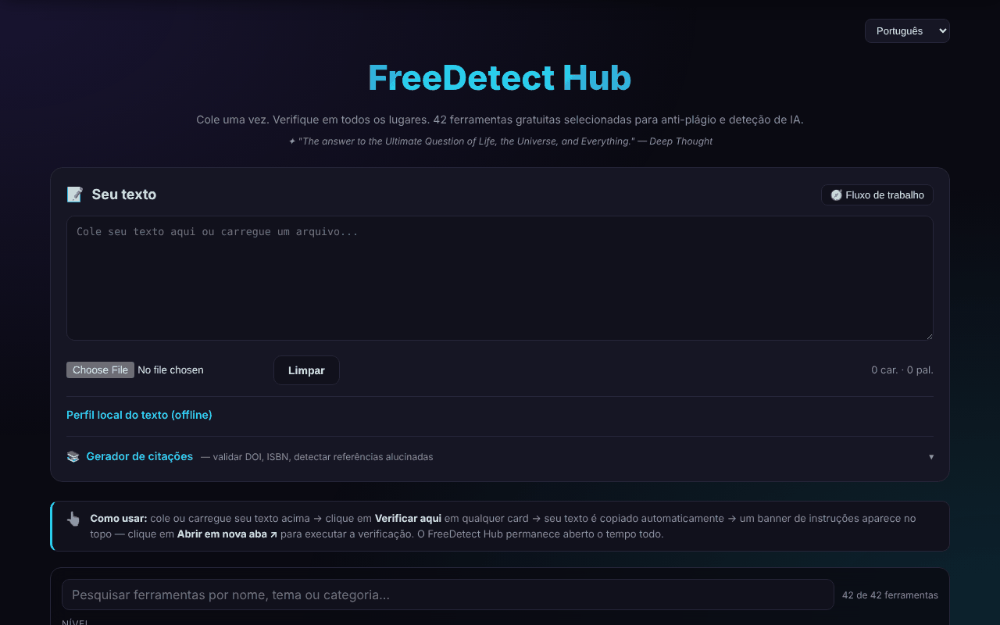

# FreeDetect Hub

[English](README.md) · [Română](README.ro.md) · [Français](README.fr.md) · [Italiano](README.it.md) · [Español](README.es.md) · **Português** · [Deutsch](README.de.md) · [Magyar](README.hu.md)

**Versão:** 1.3.6 · **Última atualização:** 2026-10-23

Um painel único para 42 ferramentas gratuitas de deteção de plágio e de texto gerado por IA, mais um gerador de citações.

**Aplicação online:** https://chiuta.github.io/FreeDetect/

## O que é

O FreeDetect Hub («Paste once. Check everywhere.») é uma aplicação HTML num único ficheiro (com as bibliotecas PDF e DOCX incluídas na diretoria `vendor/`). Cola ou carrega um texto uma só vez, depois escolhe numa grelha de 42 ferramentas externas selecionadas à mão; o texto é copiado para a área de transferência e a ferramenta escolhida abre-se num novo separador, onde o cola.

A aplicação não faz a verificação em si: é um catálogo e um auxiliar de fluxo de trabalho. Os resultados dos detetores podem ser errados (falsos positivos), sobretudo para textos que não estão em inglês, incluindo o romeno; a aplicação avisa explicitamente disso.

## Funcionalidades

- Área de texto «Your Text» para colar diretamente ou carregar ficheiros `.txt`, `.md`, `.docx`, `.pdf`.
- Grelha de ferramentas com filtros por nível (Tier: iniciantes / profissionais) e por categoria (IA, plágio, bibliografia, imagem, etc.).
- Botão «Check here» em cada ferramenta: copia o texto para a área de transferência e mostra um banner com «Open in new tab».
- Pesquisa no catálogo (nome, tema, categoria; os sinais diacríticos são ignorados), com um contador «n de 42» e uma mensagem clara quando não há resultados; Escape limpa a pesquisa.
- «Perfil local do texto (offline)»: palavras, frases, comprimento médio e a sua variação, variedade do vocabulário, tempo de leitura, DOI encontrados e expressões de três palavras repetidas. São estatísticas descritivas, não um teste de plágio nem de texto gerado por IA (o aviso é apresentado no painel). Os novos textos da pesquisa e do perfil estão traduzidos para romeno e inglês; nos outros idiomas aparecem em inglês.
- Painel «Workflow» (fluxo recomendado em 7 passos) e botão «Clear».
- Gerador de citações: introduz um DOI, ISBN ou URL, «Fetch» verifica localmente o dígito de controlo do ISBN, obtém os metadados do Crossref / OpenLibrary e produz APA, MLA, Chicago ou BibTeX, com «Copy».
- «Scan input text»: encontra os DOI no texto e verifica-os no Crossref, para assinalar referências possivelmente inventadas.
- Interface em 15 idiomas (seletor 🌐): inglês, romeno, francês, alemão, espanhol, português, italiano, neerlandês, polaco, russo, árabe, chinês, japonês, coreano, turco.
- Páginas de privacidade/RGPD, cookies e aviso legal, ligações Buy Me a Coffee.

## Novidades (1.1.0)

- **Verificação de dados pessoais antes de «Check here»**: o texto é analisado localmente; se surgirem e-mails, telefones, IBAN, CNP (números de identificação pessoal romenos), etc., pode mascarar, continuar ou cancelar. Apenas o texto copiado para a área de transferência é mascarado; a área de texto permanece inalterada.
- **Pesquisa no catálogo por relevância**, com sinónimos (plagiat/plagiarism, AI/GPT, citare, etc.) e tolerância a erros; ao lado do contador surge «· după relevanță» (por relevância). A antiga correspondência literal mantém-se.
- **«Export profile (.md)»**: guarda o perfil local do texto como ficheiro Markdown (estatísticas, não o texto).
- Os módulos comuns «fff-kit» estão incluídos; a cópia `.fff.json` da caixa de diálogo da versão contém apenas o idioma da interface.
- Os novos textos estão nos 15 idiomas da interface; **as traduções não foram verificadas por falantes nativos.**

## Manual de utilização

1. Abra a página e, se quiser, mude o idioma no seletor 🌐 (a escolha é memorizada).
2. Cole o texto em «Your Text» ou carregue um ficheiro `.txt`, `.md`, `.docx` ou `.pdf`.
3. Use os filtros Tier e Category para restringir a grelha de ferramentas.
4. Prima «Check here» em 2–3 detetores; o texto é copiado automaticamente para a área de transferência.
5. No banner que surge, prima «Open in new tab» e depois cole o texto (Ctrl+V / Cmd+V) na ferramenta aberta.
6. Compare os resultados: um único sinal não é uma prova.
7. Para as referências: abra «Citation Generator», introduza um DOI/ISBN e prima «Fetch», ou prima «Scan input text» para verificar os DOI do texto.
8. «Clear» esvazia a área de texto.

Teclado: Enter no campo do gerador de citações executa-o; Escape no campo de pesquisa esvazia-o; não há outros atalhos.

## Privacidade e rede

- Local: no `localStorage` guarda-se apenas o idioma da interface (`fdh_lang`). O seu texto não é guardado.
- O texto colado não é enviado para lado nenhum pela aplicação. Os únicos pedidos de rede da página são os do gerador de citações, quando é acionado: `api.crossref.org` (DOI e análise) e `openlibrary.org` (ISBN).
- Os pedidos ao Crossref contêm o DOI consultado, o seu endereço IP e o parâmetro `mailto=alexio@trom.tf` (o endereço de contacto do autor, usado para o «polite pool»); os dirigidos ao OpenLibrary contêm o ISBN e o IP. «Scan input text» envia ao Crossref apenas os DOI encontrados no texto, não o texto inteiro.
- Quando usa «Check here», o texto chega, através da sua colagem, ao serviço de terceiros escolhido e fica sujeito à respetiva política.
- A página contém ligações (não pedidos automáticos) para dezenas de serviços de terceiros, para o Buy Me a Coffee e para os sítios do autor.

## Aviso

As ferramentas listadas são serviços de terceiros; os resultados dos detetores de plágio e de texto gerado por IA podem ser errados (falsos positivos), sobretudo para o romeno, e não constituem prova. O catálogo inclui também ferramentas do tipo «humanizer»/paráfrase, listadas como tal, sem recomendar contornar as regras de integridade académica. As marcas pertencem aos respetivos proprietários (nomes comerciais dos seus titulares, usados de forma descritiva). As ferramentas «humanizer» são mantidas no catálogo apenas como informação sobre o que existe no mercado; o autor não as recomenda para contornar as regras de integridade académica, e a sua utilização em trabalhos sujeitos a essas regras continua a ser da responsabilidade do utilizador.

## Execução local / offline

Descarregue o repositório (o ficheiro `index.html` e a diretoria `vendor/`) e abra `index.html` num navegador. A interface, a filtragem e a leitura de ficheiros locais funcionam sem internet. Precisam de internet: o gerador de citações (Crossref, OpenLibrary) e, naturalmente, as ferramentas externas que abrir.

## Licença

MIT, conforme o cabeçalho da aplicação — ver o ficheiro LICENSE. Atenção: a diretoria `vendor/` contém bibliotecas de terceiros com as suas próprias licenças, que não são abrangidas pela licença MIT — `pdfjs/` (Mozilla pdf.js 3.x, Apache-2.0, conforme o cabeçalho do ficheiro) e `mammoth.browser.min.js` (mammoth.js, BSD-2-Clause conforme o projeto de origem; o texto da licença não está incluído no ficheiro). Pormenores em [NOTICE.md](NOTICE.md).

## Autor

Alexio — Alexandru-Ionuț Chiuță, contacto: alexio@trom.tf

## Resumo

O FreeDetect Hub é um painel HTML num único ficheiro com ligações para 42 ferramentas gratuitas, escolhidas manualmente, de deteção de plágio e de IA. Cole ou carregue texto (.txt, .md, .docx, .pdf), clique em «Check here» para o copiar para a área de transferência e abrir a ferramenta escolhida. Inclui um gerador de citações DOI/ISBN (Crossref, OpenLibrary) e um verificador de referências alucinadas. Interface em 15 idiomas. Apenas as funções de citação contactam a rede; apenas a escolha do idioma é guardada localmente.

## Auditoria

Auditoria: 2026-10-10 (ronda 2, 2026-10-11: NOTICE.md adicionado para os componentes de terceiros; nota sobre as ferramentas humanizer) — verificado: o texto colado não sai da página (CSP `connect-src` apenas `api.crossref.org` e `openlibrary.org`); corrigida uma ligação sem nome acessível (o banner «Open in new tab») e o ruído na consola causado por `frame-ancestors` no meta CSP (a diretiva é ignorada em meta; a proteção contra a inclusão em frames exige um cabeçalho HTTP).

## Histórico / Changelog

### 1.3.5 — 2026-10-22

fff-kit 1.1.4: áreas de toque e texto mínimo. Áreas de toque/texto corrigidos na aplicação.

### 1.3.4 — 2026-10-22

fff-kit 1.1.2: PBKDF2 com 600.000 iterações, proteção anti-clickjacking.

### 1.3.3 — 2026-10-22
- Legibilidade em telemóvel: as etiquetas das ferramentas e do perfil passam de 10–11 px para 12 px; as ligações do rodapé, o resumo «perfil local» e o campo de ficheiro têm agora áreas táteis de pelo menos 24 px.

### 1.3.2 — 2026-10-22
- Correção de tradução: os painéis jurídicos (privacidade/RGPD, cookies, aviso legal, termos, acessibilidade, tecnologia) estão agora totalmente traduzidos para italiano e português, o aviso de JavaScript desativado surge nos 8 idiomas e «Impressum» passa a «Aviso legal» em português.

### 14 de outubro de 2026 (v1.1.0)
- Proteção de dados pessoais antes de copiar para a área de transferência (FFF.pii).
- Pesquisa no catálogo por relevância, com sinónimos (FFF.search).
- Exportação do perfil (.md). Módulos comuns core, label, bundle, search, pii; testes: `tests/fff-r8.test.mjs`.

### 12 de outubro de 2026 (v1.0.0)
- 1.0.0 — 2026-10-12: a versão e a data da última atualização são apresentadas na aplicação

### 11 de outubro de 2026
- O contador de palavras sob o texto e «Cuvinte» (Palavras) do perfil local usam agora a mesma regra de contagem (antes: 33 contra 35 para o mesmo texto).
- O gerador de citações verifica localmente o dígito de controlo do ISBN (ISBN-10 e ISBN-13) antes de qualquer pedido: um ISBN errado recebe uma mensagem imediata, sem rede, nos 15 idiomas.
- O seletor de idioma foi movido para um marco (`header`): 0 violações axe, incluindo `region`.
- A mensagem de erro sem rede do gerador de citações é agora explícita, nos 15 idiomas (antes: «Failed to fetch»).
- Os 18 atributos `onclick` do HTML foram substituídos por atributos `data-*` e um ouvinte delegado.
- As datas de «Última atualização» das páginas legais: outubro de 2026.
- Pesquisa no catálogo de 42 ferramentas (com um estado vazio explícito) e painel «Perfil local do texto» com estatísticas descritivas offline (frases, variação, vocabulário, DOI, expressões repetidas); novos textos em romeno e inglês.
- CSP: `script-src` por hash SHA-256 em vez de `'unsafe-inline'`.
