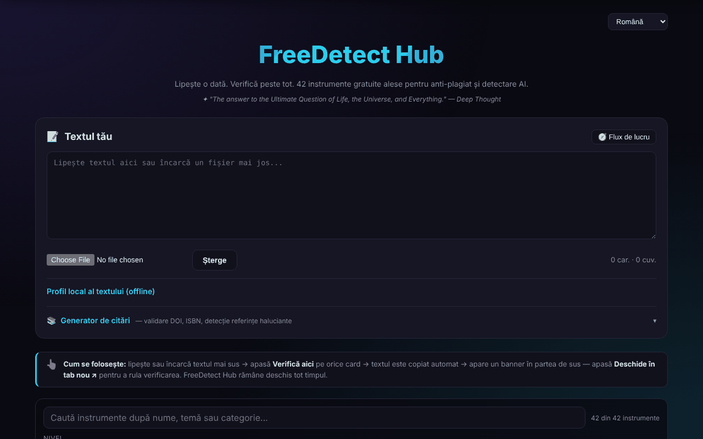

# FreeDetect Hub

[English](README.md) · **Română** · [Français](README.fr.md) · [Italiano](README.it.md) · [Español](README.es.md) · [Português](README.pt.md) · [Deutsch](README.de.md) · [Magyar](README.hu.md)

**Versiune:** 1.3.0 · **Ultima actualizare:** 2026-10-19

Un panou unic pentru 42 de instrumente gratuite de detectare a plagiatului și a textului generat de AI, plus generator de citări.

**Live:** https://chiuta.github.io/FreeDetect/

## Ce este

FreeDetect Hub („Paste once. Check everywhere.") este o aplicație HTML într-un singur fișier (cu bibliotecile PDF și DOCX incluse în directorul `vendor/`). Lipești sau încarci un text o singură dată, apoi alegi dintr-o grilă de 42 de instrumente externe selectate manual; textul este copiat în clipboard și instrumentul ales se deschide într-o filă nouă, unde îl lipești.

Aplicația nu face verificarea în sine: este un catalog și un ajutor de flux de lucru. Rezultatele detectoarelor pot fi eronate (false pozitive), mai ales pentru texte non-englezești, inclusiv română; aplicația avertizează explicit despre acest lucru.

## Funcții

- Zonă de text „Your Text" pentru lipire directă sau încărcare de fișiere `.txt`, `.md`, `.docx`, `.pdf`.
- Grilă de instrumente cu filtre pe nivel (Tier: începători / profesioniști) și pe categorie (AI, plagiat, bibliografie, imagine etc.).
- Buton „Check here" pe fiecare instrument: copiază textul în clipboard și arată un banner cu „Open in new tab".
- Căutare în catalog (nume, temă, categorie; diacriticele sunt ignorate), cu numărătoare „n din 42” și mesaj clar când nu există rezultate; Escape golește căutarea.
- „Profil local al textului (offline)”: cuvinte, propoziții, lungime medie și variația ei, varietatea vocabularului, timp de citire, DOI găsite și expresii de trei cuvinte repetate. Sunt statistici descriptive, nu un test de plagiat sau de text generat de AI (avertismentul este afișat în panou). Textele noi ale căutării și ale profilului sunt traduse în română și engleză; în celelalte limbi apar în engleză.
- Panou „Workflow" (flux recomandat în 7 pași) și buton „Clear".
- Generator de citări: introduci un DOI, ISBN sau URL, „Fetch" verifică local cifra de control a ISBN-ului și aduce metadatele de la Crossref / OpenLibrary și produce APA, MLA, Chicago sau BibTeX, cu „Copy".
- „Scan input text": găsește DOI-urile din text și le verifică la Crossref, pentru a semnala referințe posibil inventate.
- Interfață în 15 limbi (selector 🌐): engleză, română, franceză, germană, spaniolă, portugheză, italiană, olandeză, poloneză, rusă, arabă, chineză, japoneză, coreeană, turcă.
- Pagini de confidențialitate/GDPR, cookies și impressum, link-uri Buy Me a Coffee.

## Funcții noi (1.1.0)

- **Verificare de date personale înainte de „Check here”**: textul este scanat local; dacă apar e-mailuri, telefoane, IBAN, CNP etc., poți mascarea, continua sau anula. Se maschează doar textul copiat în clipboard; zona de text rămâne neschimbată.
- **Căutare în catalog după relevanță**, cu sinonime (plagiat/plagiarism, AI/GPT, citare etc.) și toleranță la greșeli; apare „· după relevanță” lângă numărătoare. Potrivirea literală veche rămâne.
- **„Export profile (.md)”**: salvează profilul local al textului ca fișier Markdown (statistici, nu textul).
- Modulele comune „fff-kit” sunt incluse; copia `.fff.json` din dialogul versiunii cuprinde doar limba interfeței.
- Textele noi sunt în toate cele 15 limbi ale interfeței; **traducerile nu au fost verificate de vorbitori nativi.**

## Manual de utilizare

1. Deschide pagina și, dacă vrei, schimbă limba din selectorul 🌐 (opțiunea este reținută).
2. Lipește textul în „Your Text" sau încarcă un fișier `.txt`, `.md`, `.docx` ori `.pdf`.
3. Folosește filtrele Tier și Category pentru a restrânge grila de instrumente.
4. Apasă „Check here" pe 2-3 detectoare; textul este copiat automat în clipboard.
5. În bannerul care apare apasă „Open in new tab", apoi lipește textul (Ctrl+V / Cmd+V) în instrumentul deschis.
6. Compară rezultatele: un singur semnal nu este o dovadă.
7. Pentru referințe: deschide „Citation Generator", introdu un DOI/ISBN și apasă „Fetch", sau apasă „Scan input text" pentru a verifica DOI-urile din text.
8. „Clear" golește zona de text.

Tastatura: Enter în câmpul generatorului de citări îl rulează; Escape în câmpul de căutare îl golește; nu există alte scurtături.

## Confidențialitate și rețea

- Local: în `localStorage` se reține doar limba interfeței (`fdh_lang`). Textul tău nu este salvat.
- Textul lipit nu este trimis nicăieri de aplicație. Singurele cereri de rețea ale paginii sunt cele ale generatorului de citări, la acționarea lui: `api.crossref.org` (DOI și scanare) și `openlibrary.org` (ISBN).
- Cererile către Crossref conțin DOI-ul interogat, adresa ta IP și parametrul `mailto=alexio@trom.tf` (adresa de contact a autorului, folosită pentru „polite pool”); cele către OpenLibrary conțin ISBN-ul și IP-ul. „Scan input text” trimite către Crossref doar DOI-urile găsite în text, nu textul întreg.
- Când folosești „Check here", textul ajunge, prin lipirea ta, la serviciul terț ales și intră sub politica acestuia.
- Pagina conține link-uri (nu cereri automate) către zeci de servicii terțe, către Buy Me a Coffee și site-urile autorului.

## Avertisment

Instrumentele listate sunt servicii terțe; rezultatele detectoarelor de plagiat și de text generat de AI pot fi eronate (false pozitive), mai ales pentru română, și nu constituie dovadă. Catalogul include și instrumente de tip „humanizer”/parafrazare, listate ca atare, fără a recomanda eludarea regulilor de integritate academică. Mărcile aparțin proprietarilor lor (nume comerciale ale deținătorilor lor, folosite descriptiv). Instrumentele de „humanizer” sunt păstrate în catalog doar ca informare despre ce există pe piață; autorul nu le recomandă pentru a eluda regulile de integritate academică, iar utilizarea lor în lucrări supuse acestor reguli rămâne responsabilitatea utilizatorului.

## Rulare locală / offline

Descarcă repository-ul (fișierul `index.html` și directorul `vendor/`) și deschide `index.html` în browser. Interfața, filtrarea și citirea fișierelor locale funcționează fără internet. Au nevoie de internet: generatorul de citări (Crossref, OpenLibrary) și, desigur, instrumentele externe pe care le deschizi.

## Licență

MIT, conform antetului aplicației — vezi fișierul LICENSE. Atenție: directorul `vendor/` conține biblioteci terțe cu licențele lor, care nu sunt acoperite de licența MIT — `pdfjs/` (Mozilla pdf.js 3.x, Apache-2.0, conform antetului fișierului) și `mammoth.browser.min.js` (mammoth.js, BSD-2-Clause conform proiectului sursă; textul licenței nu este inclus în fișier). Detalii în [NOTICE.md](NOTICE.md).

## Autor

Alexio — Alexandru-Ionuț Chiuță, contact: alexio@trom.tf

## Rezumat

FreeDetect Hub este un panou într-un singur fișier HTML cu linkuri către 42 de instrumente gratuite, alese manual, de detectare a plagiatului și a textelor AI. Lipești sau încarci text (.txt, .md, .docx, .pdf), apeși „Verifică aici” pentru a-l copia în clipboard și a deschide instrumentul ales. Include un generator de citări DOI/ISBN (Crossref, OpenLibrary) și un scaner de referințe halucinate. Interfață în 15 limbi. Doar funcțiile de citare contactează rețeaua; local se stochează doar limba aleasă.

## Audit

Audit: 2026-10-10 (rundă 2, 2026-10-11: NOTICE.md adăugat pentru componentele terțe; notă despre instrumentele humanizer) — verificat: textul lipit nu pleacă din pagină (CSP `connect-src` doar `api.crossref.org` și `openlibrary.org`); corectat un link fără nume accesibil (bannerul „Open in new tab”) și zgomotul din consolă cauzat de `frame-ancestors` în meta CSP (directiva este ignorată în meta; protecția la framing cere antet HTTP).

## Istoric / Changelog

### 14 octombrie 2026 (v1.1.0)
- Protecție de date personale înainte de copierea în clipboard (FFF.pii).
- Căutare în catalog după relevanță, cu sinonime (FFF.search).
- Export profil (.md). Module comune core, label, bundle, search, pii; teste: `tests/fff-r8.test.mjs`.

### 12 octombrie 2026 (v1.0.0)
- 1.0.0 — 2026-10-12: versiunea și data ultimei actualizări sunt afișate în aplicație

### 11 octombrie 2026
- Contorul de cuvinte de sub text și „Cuvinte” din profilul local folosesc acum aceeași regulă de numărare (înainte: 33 față de 35 pentru același text).
- Generatorul de citări verifică local cifra de control a ISBN-ului (ISBN-10 și ISBN-13) înainte de orice cerere: un ISBN greșit primește mesaj imediat, fără rețea, în toate cele 15 limbi.
- Selectorul de limbă a fost mutat într-un reper (`header`): 0 încălcări axe, inclusiv `region`.
- Mesajul de eroare fără rețea la generatorul de citări este acum explicit, în toate cele 15 limbi (înainte: „Failed to fetch”).
- Cele 18 atribute `onclick` din HTML au fost înlocuite cu atribute `data-*` și un ascultător delegat.
- Datele „Ultima actualizare” din paginile legale: octombrie 2026.
- Căutare în catalogul de 42 de instrumente (cu stare goală explicită) și panou „Profil local al textului” cu statistici descriptive offline (propoziții, variație, vocabular, DOI, expresii repetate); texte noi în română și engleză.
- CSP: `script-src` pe hash SHA-256 în loc de `'unsafe-inline'`.
